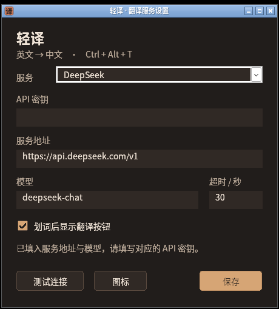
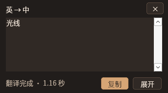
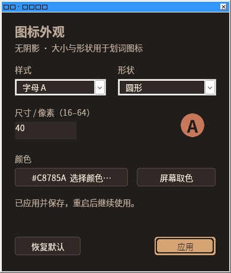

# 轻译 · LingoLeaf

面向 Windows 的轻量英文划词翻译工具。使用 Rust 和原生 Win32 界面，托盘常驻，支持选中文字后点击图标翻译，也可选择直接显示译文，或使用全局快捷键。应用调用用户配置的翻译 API 显示中文译文，界面采用简洁的暖色暗色主题，不依赖浏览器或 WebView。

当前版本 **0.4.2**，代码在 `lingoleaf` 开发分支维护。本版修正浏览器文档的选区搜索和预热，并增加默认关闭的“兼容取词”选项，供网页或 PDF 无法直接读取选区时尝试临时复制。连续划词仍复用同一个紧凑小框，更新位置、读取状态和译文；点击图标后也在小框中显示，可展开查看。保留可自定义图标、流式译文、内存缓存及连接复用。更新时先从托盘退出旧版本，再解压运行新版；已保存的 API 配置继续使用，升级不会自动开启兼容取词。版本变化见 [更新记录](CHANGELOG.md)，打包与迭代流程见 [版本管理说明](docs/releasing.md)。



截图来自 0.4.0 的 Wine 兼容层。Windows 11 标题栏通过 DWM 应用暗色，系统外观可能不同。

当前是开发测试版。目标平台是 Windows 11 x64；Windows 10 兼容性需要单独验证。跨软件取词、焦点、剪贴板、DPI 和资源占用须在 Windows 实机或虚拟机上验收，构建通过不能代替这些检查。验收记录见 [Windows 验证清单](docs/windows-validation.md)。

## 使用

1. 启动 `lingoleaf.exe`，在系统托盘中找到“轻译”。
2. 首次运行会打开设置页。填写服务地址、模型、API Key 和超时时间，点击“测试连接”验证后保存；之后也可从托盘菜单打开设置。
3. 在其他程序中选中英文，默认点击出现的划词按钮（“译”）翻译；在设置里的“划词模式”可改为直接显示译文。也可以按 **Ctrl + Alt + T** 获取选区并翻译。
4. 网页或 PDF 暂时读不到选区时，可按下文说明主动开启“兼容取词”，或自行复制文本后使用托盘菜单中的“翻译剪贴板”。该菜单只读取剪贴板，不发送复制按键。
5. 从译文小框复制结果，长内容可展开查看；浮窗获得焦点后可按 Esc 关闭。关闭设置或浮窗会保留托盘进程，退出程序请使用托盘菜单。

取词默认只读，不模拟复制。程序优先使用 Windows UI Automation，结合鼠标位置命中的文档子树、焦点和有限范围的关联元素查找真实选区；支持的传统文本控件也可读取其选区。浏览器文本 PDF 会检查选区范围与本次手势位置，结合前台文档的后台预热、选区通知和有界延迟重试，等待阅读器更新选区。本版修正祖先搜索过早截止和文档搜索预算，并显式使用 Raw View 缓存；这些是读取路径的修正，尚不能据此认定 Edge 问题的根因。程序不将整页或整个控件内容当作选中文字；窗口切换、后续选区和取消操作会使过期结果失效。

是否可读取仍取决于浏览器、阅读器和目标控件，不能保证所有页面均可划词。0.4.2 的 Windows 浏览器验收状态见 [构建记录](docs/build-validation.md) 和 [验证清单](docs/windows-validation.md)。本轮 Edge 安装包下载受云环境网络策略阻断，未完成 Edge 实机验证；Chrome 的结果不能替代 Edge 验收。扫描 PDF、图片或无法复制的内容需用其他 OCR 工具识别并复制，再使用“翻译剪贴板”；应用尚未提供 OCR。管理员窗口、自绘画布、游戏及远程桌面内部的文字也不在保证范围内。程序不应为获取文字默认要求管理员权限。

### 划词模式

在设置页“启用自动划词”右侧选择模式并保存：

| 模式 | 选中文字后的行为 | 何时发送翻译请求 |
|---|---|---|
| 点击图标翻译（默认） | 先显示划词图标，点击后在紧凑小框显示译文，可展开查看 | 点击图标时 |
| 直接显示译文 | 显示紧凑译文小框，不主动抢走当前软件焦点；支持的服务逐段显示译文 | 读取到有效选区后自动发送 |

选择“直接显示译文”意味着后续成功获取的鼠标选区会自动发送到所配置的翻译服务，并可能产生费用。想先确认每次发送的内容，可保留默认的点击模式。两种模式默认只读选区，不模拟复制；只有主动开启下述兼容取词才允许受限的临时复制。相同文本的有效缓存命中不会再次调用 API。



上图来自 0.4.0 的 Wine 兼容层，仅展示旧版小框外观，不作为 0.4.2 兼容取词或浏览器改进的验收证据。

连续选中不同内容时，复用同一个小框并移动到新选区附近，更新读取、翻译状态和译文；相同单词在不同位置再次选中也属于新一次划词，缓存命中仍会更新位置。新的选区正在读取时，上一请求后到的流式内容或最终结果不会覆盖它。默认点击模式仍需点击本次图标才发送翻译请求。

划词总开关默认开启；关闭后，两种自动划词模式都停止，快捷键和“翻译剪贴板”仍可使用。配置字段 `selection_button` 保留为这一总开关。短距离拖选、双击/三击和 Shift + 单击会触发选区检查；键盘选区可使用快捷键主动翻译。无法读取选区的软件可以自行复制，再使用“翻译剪贴板”。

快捷键取词可尝试受限的复制回退，使用相同的多格式备份与恢复流程；原剪贴板包含无法完整备份的格式时停止，不发送复制按键，并提示手动复制。“翻译剪贴板”只读取用户已复制的文字，不模拟复制。

### 网页与 PDF 兼容取词

在设置勾选 **“兼容取词（网页 / PDF，临时复制）”** 后保存，可为已识别浏览器中的正文或 PDF 增加一次复制回退。该选项默认关闭，旧配置升级后也保持关闭；它不会改变“点击图标翻译”与“直接显示译文”的发送时机。

仅当本次有明确的物理划选手势（拖选、双/三击或 Shift + 单击）、只读取词失败，而且来源确认是受支持的浏览器文档或 PDF 时，才会尝试一次 **Ctrl + C** 获取当前选区。普通单击、工具栏或地址栏、其他程序和已取消的操作不会因此触发自动复制。默认点击模式获取文本后仍只显示图标，点击才发送 API 请求；直接模式则按已选择的设置自动发送。

临时复制前会尝试完整快照当前剪贴板；支持可完整保存的文本、HTML、RTF、DIB 等数据，并在操作后恢复当前剪贴板内容。未知私有格式、不能完整恢复的 GDI/OLE 数据等会拒绝操作，不先清空剪贴板。取消、来源窗口改变或剪贴板序列变化时会停止或放弃恢复，避免将旧快照覆盖到用户新复制的内容上；系统恢复失败时会提示重新复制。恢复范围是当前剪贴板，**不承诺回滚 Windows 剪贴板历史或其他程序已观察到的复制事件**。

兼容取词也可能失败，例如网页禁止复制、扫描 PDF 没有文字、剪贴板无法完整快照或来源无法确认。界面提示“暂未读取到这次选区”表示本次读取未成功，不能据此认定页面没有文本。可重新划选，或自行复制后使用“翻译剪贴板”。兼容取词只影响鼠标划词流程，快捷键的受限回退和手动剪贴板入口保持各自行为。

### 图标外观

在设置的“图标外观”或托盘同名入口中，可选择 **叶片 / 译字 / 字母 A** 样式、**圆角 / 方形 / 圆形** 形状，设置 **16–64 逻辑像素**的划词图标大小，并自定义颜色。默认大小为 32 逻辑像素，默认形状为圆角；应用后保存，重启后保留。

颜色可在系统颜色选择器中输入 RGB 数值，或使用“屏幕取色”：启动后在目标颜色上单击，按 **Esc** 或右键可取消并保留原色，点击“应用”保存。图标大小随当前显示器 DPI 缩放，例如 32 逻辑像素在 150% 缩放下为 48 个物理像素；托盘与窗口图标使用系统要求的尺寸。

划词图标使用按像素透明浮层，仅绘制图标，不添加阴影或不透明外围；隐藏后应恢复下方画面，不留下残影。设置和普通译文窗口的系统外框仍由 Windows 管理。实际外观、跨屏缩放与残影情况需按 [Windows 验证清单](docs/windows-validation.md) 验收。



上图展示 0.4.0 的形状、尺寸、颜色和屏幕取色；屏幕取色不创建遮罩，也不保存桌面截图。

这一选项修改运行中的图标。Windows 资源管理器展示的 EXE 文件图标来自构建时嵌入的固定资源，不会随设置改写。

### 翻译响应与缓存

- **增量显示**：服务返回兼容 SSE 流式响应时，译文逐段显示，首段可以早于整段翻译完成；返回标准 JSON 的服务会在完整响应后显示。
- **重复翻译**：成功结果只保存在内存中，最多 64 项，原文与译文合计最多 512 KiB，每项 10 分钟过期。相同服务、模型和密钥下再次翻译相同文本，缓存命中后直接显示结果，不再次调用 API；重启会清空缓存。
- **连续操作**：每次新划词更新显示位置和状态，复用紧凑小框；合并重复请求，只保留最新待处理翻译。过期结果不会覆盖新选区的读取状态或译文。在网络操作之间检查取消状态，停止处理已过期的流式内容。
- **连接复用**：同一服务复用 HTTP 会话和连接，减少重复建立连接的开销；网络和 UI 分别在工作线程与界面线程处理。

首次翻译的时间仍取决于网络、服务排队、模型和文本长度。流式显示改善首段等待感受，不保证缩短服务生成完整译文的时间；同步网络阶段需要返回或超时后才能响应取消，超时按网络阶段生效，不是严格的整体截止时间。当前验证结果见 [构建验证记录](docs/build-validation.md)，真实 Windows 和实际服务速度仍需按 [验证清单](docs/windows-validation.md) 测量。

OCR 框选翻译、离线模型、自动更新和云同步尚未提供。

## 配置翻译 API

当前支持 **OpenAI Chat Completions 兼容协议**，翻译请求使用 `stream: true`，可处理兼容 SSE 流及普通 JSON 响应。服务需接受该请求参数；专用翻译服务或其他协议变体需要各自适配。

| 设置 | 说明 |
|---|---|
| 服务 | 选择 DeepSeek、OpenAI 或自定义兼容服务；切换预设会清空密钥，请填写对应服务的密钥 |
| 服务地址 | API 基础地址，通常包含 `/v1`，例如 `https://api.openai.com/v1`；程序在其后使用 `/chat/completions` |
| 模型 | 服务实际提供的模型名称，例如 `gpt-4o-mini`；模型是否可用由服务和账户决定 |
| API Key | 对应服务的密钥；不要求认证的本地服务可以留空 |
| 超时 | 请求的超时秒数，用于限制网络等待 |
| 划词总开关 | 开启或关闭鼠标划词功能；同时控制点击和直接显示两种模式 |
| 划词模式 | 默认点击图标翻译；可主动选择读取选区后自动显示译文 |
| 兼容取词 | 默认关闭；保存后，仅对明确的浏览器正文/PDF 划选在只读失败时尝试一次临时复制 |
| 图标外观 | 选择叶子、译、A 样式，圆角、方形、圆形，16–64 逻辑像素大小及颜色；支持屏幕取色 |

远程服务必须使用 HTTPS；本机 loopback 地址可使用 HTTP，以便连接本地兼容服务。URL 不应包含用户名、密码、查询参数或 fragment。改变服务地址时，应确认密钥属于该服务。

### 使用 DeepSeek

如果密钥是在 [DeepSeek 开放平台](https://platform.deepseek.com/) 创建的，选择 **DeepSeek** 预设，然后填写：

| 设置 | 内容 |
|---|---|
| 服务地址 | `https://api.deepseek.com/v1` |
| 模型 | `deepseek-chat` |
| API Key | 自己在 DeepSeek 开放平台生成的有效密钥 |
| 超时 | 可先使用预设的 30 秒 |

点击“测试连接”，成功后保存。`/v1` 是兼容 API 路径；应用会组成 `https://api.deepseek.com/v1/chat/completions`。官方模型仓库中的 [OpenAI 兼容调用示例](https://github.com/deepseek-ai/DeepSeek-V2#7-api-platform) 使用这一服务地址与 `deepseek-chat`。账号实际可用模型及额度仍以开放平台为准。

“订阅”可能指网页聊天服务，也可能指第三方提供的 API 套餐。仅凭密钥前缀不能判断服务来源或额度；聊天订阅不应直接视为已包含官方 API 额度。如果购买的是第三方订阅或中转服务，请选择自定义服务，并使用它提供的服务地址、模型名和密钥，不能直接套用官方地址。

切换预设只填入地址、模型等非敏感配置，不会内置共享密钥，也不会覆盖已保存的设置，直到点击保存。已公开发送过的密钥应在对应服务后台撤销，并重新生成后填写；不要将密钥发到聊天、issue 或代码仓库。

翻译方向固定为英文到简体中文，输出按纯文本显示。请求会把所选文字发送到配置的服务，费用、数据处理方式及模型可用性由该服务决定；应用不提供共享密钥，也不需要自建中转服务。

设置保存在当前用户的 `%LOCALAPPDATA%\LingoLeaf` 下。API Key 使用当前用户范围的 Windows DPAPI 保护，不应以明文写入普通配置、日志或仓库。DPAPI 用于保护静态存储，不能抵抗已取得同一用户权限的恶意软件；也不要假定配置可以连同密钥直接迁移到另一台机器。

从旧版本升级时，现有服务、模型、密钥、图标样式和颜色继续使用；缺少的新字段补充为点击模式、32 逻辑像素和圆角形状。新增的 `compatibility_capture` 缺省为 `false`，即使旧配置已使用直接显示模式，也不会自动开启临时复制。原先关闭划词的配置仍保持关闭；升级不会自动启用直接发送选区。

## 构建

Windows 上安装稳定版 Rust（MSVC 工具链）及 Visual Studio Build Tools 的“使用 C++ 的桌面开发”组件和 Windows SDK，然后在仓库根目录运行：

```powershell
cargo fmt --all -- --check
cargo test --locked --all-targets
cargo clippy --locked --all-targets -- -D warnings
cargo build --release --locked
.\target\release\lingoleaf.exe
```

可执行文件位于 `target\release\lingoleaf.exe`。使用 Python 3.12 或以上版本生成带文档的 ZIP、独立 EXE 和校验和：

```powershell
python tools/release.py --check
python -m unittest discover -s tools -p test_release.py
python tools/release.py --exe target/release/lingoleaf.exe --out-dir dist
```

输出文件包含版本号，例如 `dist\lingoleaf-0.4.2-windows-x64.zip`，校验和保存在 `dist\SHA256SUMS`。包内不包含用户配置、密钥、缓存或测试助手。当前没有签名安装器或自动更新器，公开分发前仍需完成 Windows 验收；操作步骤见 [版本管理说明](docs/releasing.md)。

在可交互的 Windows 桌面上，可先退出正在使用的轻译，再运行原生 UI 回归检查：

```powershell
cargo run --locked --example ui_smoke -- target\release\lingoleaf.exe
```

检查会使用独立临时配置启动测试实例，将焦点保持在设置顶层窗口，并验证空闲 CPU、服务预设、切换密钥清空及正常退出，不会调用翻译 API，也不会操作已经运行的用户实例。Wine 可以用于兼容层回归，结果需与 Windows 实机验收区分。

连续划词控制器可另用 `cargo run --locked --example selection_smoke -- target\release\lingoleaf.exe` 验证。它使用独立临时配置、原生 EDIT 测试窗口和本地 SSE 服务，核对同一小框的位置更新、旧响应隔离、在途与缓存去重，以及空选区和密码框不发送请求；不访问真实翻译服务。实际鼠标钩子和浏览器 PDF 仍按 Windows 清单单独验收。

Linux 可以运行可移植配置、请求和响应处理的测试：

```sh
cargo test --locked --all-targets
```

Windows 原生交互不能在 Linux 测试中得到验证。分支推送、PR、`vX.Y.Z` 标签及手动运行都可触发 CI；Windows 任务执行格式检查、测试、Clippy、版本核对和 release 打包，上传 `lingoleaf-windows-x64` 产物。Linux 任务运行可移植测试和打包脚本测试。CI 不使用真实 API Key，也不自动创建 GitHub Release；构建成功不代表已经完成交互验收。

当前云端构建与测试记录见 [构建验证记录](docs/build-validation.md)。

## 开发边界

- UI 线程只处理窗口交互；UI Automation 和网络请求放在工作线程。
- 优先读取真实选区，不将整个控件内容冒充选中文字。
- 剪贴板回退必须保留用户数据；无法安全恢复时，应提示用户自行复制。
- 不持久化翻译历史；缓存仅在内存中保留有限时间，日志不得包含 API Key 或所选原文。
- API 错误、超时、无选区及不支持的目标软件需要明确反馈。
- 体积、内存、空闲 CPU 和 Windows 兼容性均以实测为准，不把框架选型视作性能结果。

本项目尚未声明开源许可证。
