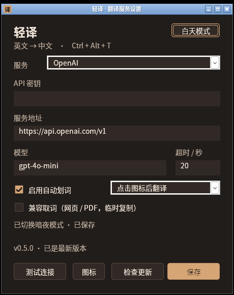
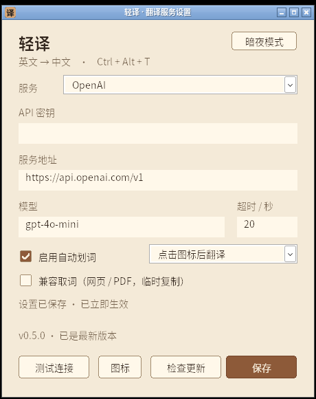

# 0.5.0 构建验证记录

日期：2026-11-05。分支：`lingoleaf`。本记录区分 Linux 逻辑测试、Wine 兼容层、隔离安装副本与真实已发布更新源。未执行的 Windows 实机、Edge 和远端发布项目不视为通过。

环境：Debian 13 x64、Rust 1.99.1、MinGW-w64、Wine 10 / Xvfb。交付目标为 `x86_64-pc-windows-gnu` GUI EXE，780800 字节，仅导入 Windows 系统 DLL；Actions 另配置 MSVC 静态 CRT 构建。远端 Actions 结果尚未核验。

| 检查 | 结果 |
|---|---|
| Rust fmt / Linux 与 Windows GNU Clippy `-D warnings` | 通过 |
| Linux 全部 targets 单测 | 47 项通过，0 失败 |
| Windows 全部 targets 测试编译、链接 | 通过 |
| 最终 Windows lib 测试（Wine） | 114 项通过，0 失败，9.70 秒 |
| UI smoke（启动 / 保存 / 主题 / 原设置） | 最终候选通过，4.48 秒 |
| 连续划词控制器 smoke | 通过，6.14 秒，2 个本地 POST |
| 更新 helper 隔离副本 smoke | 带 UAC 守卫的最终版本通过，5.94 秒 |
| 更新提示与下载 UI | 最终候选通过本地 WinHTTP 替身流程，未联系真实 GitHub |
| 版本与打包工具 | 12 项测试通过，Cargo / 锁文件 / 资源 / 更新记录与 `v0.5.0` 一致 |
| Windows x64 release | 构建通过，未增加第三方运行时依赖 |

## 启动、保存与主题

扩展的 `examples/ui_smoke.rs` 不再主动补发打开设置命令，以直接验证启动行为。测试覆盖首次启动、已保存配置后的启动、重复启动激活原 HWND，均检查可见性、焦点和显示器可用区域中心。重复启动不清空已经打开页面中的未保存草稿。设置顶层静置 2 秒的 CPU 增量为 0.0000 秒。

保存使用真实按钮和所属原生消息框，核对标题“轻译 · 保存成功”、正文“设置保存成功，已立即生效。”及 OK。随后改动表单、关闭重开，在不重启进程的情况下核对内存配置已应用。无效配置不显示成功；API 密钥不出现在提示正文。

主题按钮实际改变像素颜色并写入 `theme_mode`；Light 使用米黄 `#F4EAD8`，Dark 保留暖棕。测试检查即时切换、JSON、Light 重启恢复及切回 Dark，并继续验证模式、兼容开关、图标形状/大小、预设及保存。主题切换只保存当前主题，不误保存或清空 API 草稿。

Wine 的原生 MessageBox 正文字体缺少 CJK 回退；标题、Unicode 正文、按钮及窗口所属关系通过 API 核对正确，主页面中文正常。原生弹窗字体与 Windows DWM 外观仍需实机验收，不将 Wine 缺字当作已验收的 Windows 字形效果。

## 更新协议与下载

固定更新源：`https://github.com/xiaoxiaoawei/test-hub/releases/latest/download/update.json`。只接受本仓库稳定版本、对应标签及对应 EXE 文件名。检查与下载使用独立 WinHTTP 会话，不携带翻译密钥；下载只在用户同意后执行。

纯逻辑 / WinHTTP 测试覆盖数值版本比较、拒绝降级及预发行格式、固定来源与受限跳转、清单字段/大小、SHA-256 标准向量与分块、截断或过长响应、无认证头、损坏文件，以及 PE32+/x64/GUI/非 DLL 与内嵌版本验证。下载和执行前均校验；执行边界持有禁止写入和删除的只读句柄。

真实公开 feed 尚未完成有更新的分发验收。本次通过继承网络代理匿名访问仓库为 HTTP 200，而固定 latest 更新清单实际为 HTTP 404，当前尚无可用的公开更新资产。客户端将 404 显示为“暂无已发布更新”，不误报“已是最新”。启动时检查失败只显示状态，不阻塞设置；只有发现更高版本才自动提示下载。

## 安装、重启与回滚

`examples/update_smoke.rs` 使用随机临时安装目录、独立 LOCALAPPDATA、自身的 parent 副本以及两个真实 PE64 GUI 版本资源为 0.5.1 的本地 fixture。它不联系更新源，不使用密钥，也不覆盖 `target` 下的交付 EXE。

成功分支验证助手先确认真实父进程身份、等待父进程退出、在原目录替换、启动确认及清理备份；失败 fixture 退出 43 且不确认启动，验证精确恢复旧 EXE 哈希并重新启动旧副本。原版 0.4.2 不含更新入口，这项不冒充“原版 0.4.2 已能自动升级”。正常 0.5.0 GUI 另验证 `notify_startup_ready` 确实在配置页初始化后发出。

UAC split token 已提权 Full 状态拒绝自动替换，Default / Limited 可用；无法查询时失败关闭，不尝试自行提权。Wine 实际查询为 `TokenElevationType=3`、`TokenIsElevated=0`，没有加入生产测试绕过。

## 本地模拟更新界面

测试会在随机隔离副本旁放仅测试用 `winhttp.dll`，仅该子进程使用 DLL 替身。固定 GitHub URL 返回本地严格清单及真实 0.5.1 fixture 文件；生产客户端仍实际执行大小、SHA、PE 和版本校验。没有添加生产任意 feed 覆写入口，不进行真实外网请求。该测试只证明界面与状态流，不等同于真实 GitHub 联通或已公开发布了 0.5.1。

最终候选已通过：启动自动发现模拟 0.5.1 → 原生下载提示 → 确认下载 → 生产大小 / SHA / PE64 / 内嵌版本校验 → 原生重启确认选择“否”。之后配置页可继续使用，按钮保留“重启更新”，源 EXE 哈希没有改变。再用 Current 模拟源启动，手动检查弹出当前版本信息，并验证 Light 持久化及保存成功提示。所有测试替身请求均没有认证头，也没有访问真实外网。

这些操作与本次本地交付的 GNU EXE 使用相同字节，其 SHA-256 为 `987117663b90f8d08a770f7b2187a938436e65b191df28c454d4bbb9500eefb8`。CI 的 MSVC 构建应使用该构建随附的更新清单和 `SHA256SUMS`，不能与本地 GNU 哈希混用。模拟的 0.5.1 只在测试临时目录存在，没有发布该版本。

## 发布与仍需验证

- 标签构建通过后工作流准备草稿 Release，上传 EXE / ZIP / SHA256SUMS / update.json。草稿不进入客户端 latest 更新源；需要维护者公开发布后才可被发现。
- 真实公开 feed、真实下载 CDN、Windows 实机重启替换、混合 DPI / 多屏负坐标，以及目录权限失败保持待验收。已有 Chromium 103 / PDFium 的 0.4.2 记录不冒充本轮 Edge 验证。
- 本轮 UI / 本地 HTTP / helper 测试不消耗翻译 API，也不测量真实 DeepSeek 延迟、质量或费用。未使用聊天中的密钥。
- 设置仍保存在当前用户 `%LOCALAPPDATA%\LingoLeaf`，API Key 继续 DPAPI 保护；更新只替换 EXE。已保存的服务、模型、模式、图标与兼容选项保留，旧配置默认为暗夜。

当前产物未签名，无安装器或后台静默升级服务。应用内下载和重启都需用户选择。
