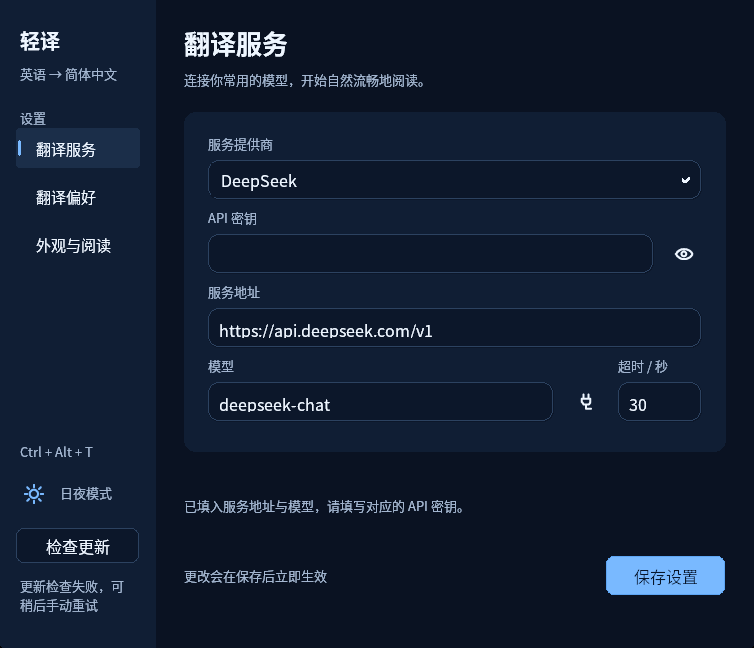
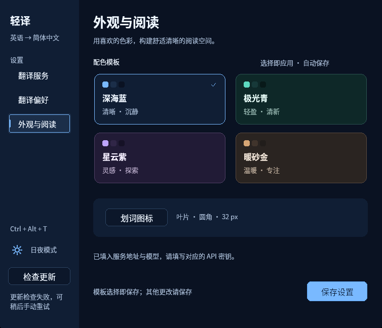
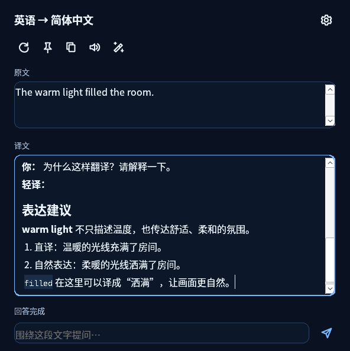
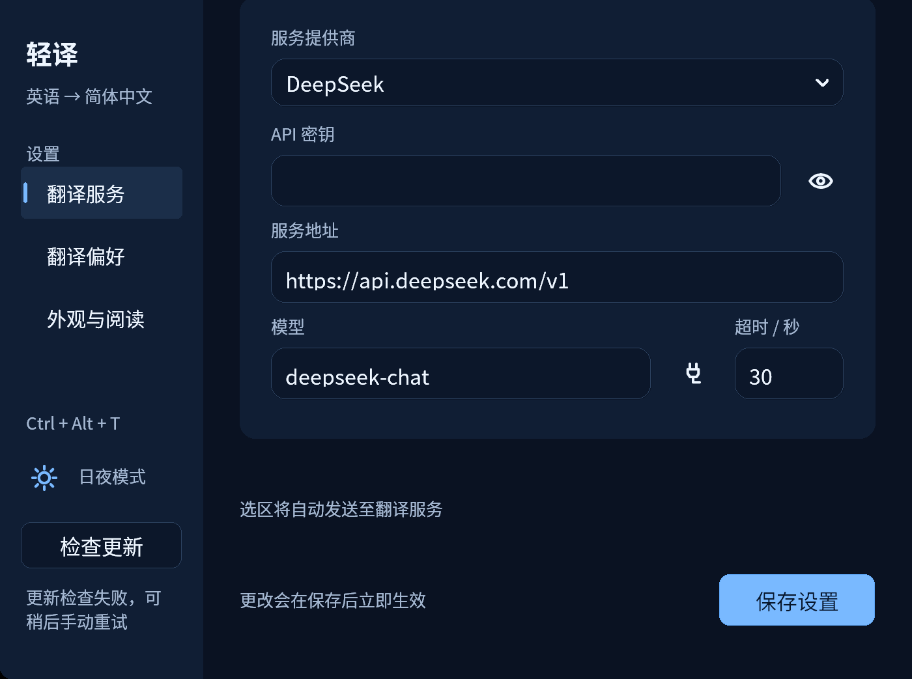

# 0.9.0 构建验证记录

日期：2026-11-07。分支：`lingoleaf`。本轮为侧栏界面、Markdown 阅读、高清图标、本机朗读和一键检查润色更新。旧版记录保留在对应标签；本记录区分已执行检查、兼容层交互和原生 Windows 实机结果。发行包保留打包时的记录，公开分发与升级结果在发布后补记。

环境：Debian 13、Rust 1.99.1、Windows GNU 交叉工具链、Wine 10 / Xvfb；原生 CI 使用 Windows runner / MSVC 静态 CRT。没有真实翻译密钥，所有模型请求使用本机模拟服务。

| 检查 | 结果 |
|---|---|
| Linux 全 targets 单元测试 | 76/76 通过 |
| Linux 全 targets 严格 Clippy | 通过 |
| Windows GNU release / 全 targets 测试编译 | 构建通过；不当作已运行测试 |
| Windows GNU 全 targets 严格 Clippy | 通过 |
| Markdown 解析与安全转义 | 11 项跨平台测试通过；真实 RichEdit 格式与复制已验 |
| Wine Windows lib | 166 通过、0 失败、1 项明确过滤；10.246 秒 |
| 三页设置 / 八种配色 | 最终候选通过；9.241 秒 |
| Markdown / 问答 / 润色交互 | 21 次本地 POST 通过；9.495 秒 |
| 更新 helper 成功 / 回滚 | 0.9.1 固定夹具替换 / ACK / 精确回滚通过；8.245 秒 |
| 发行工具与版本一致性 | Python 14/14、版本检查通过 |
| 原生 Windows 全测试 / 构建 / 打包 | [最终源码分支 CI 通过](https://github.com/xiaoxiaoawei/test-hub/actions/runs/42343760492)，无过滤；最终标签待核验 |
| 固定 150% / 200% DPI | 独立 Wine profile 实际 144 / 192 DPI；字段 60 / 80 px，滚动至保存并实际保存通过 |
| 空白划选 | Direct / Click 共 8 个真实输入负例，全部零 Show / 零可见采样 / 零 POST；保持内容不变 |
| 公开更新源 / 旧版实际升级 | 待发布后验证 |
| Windows 11 / Edge / 混合 DPI / 实际语音发声 | 未执行，不能用 Wine 或无音频测试替代 |

## 实现与测试重点

界面参照资料和布局决定见 [设计说明](design-0.9.0.md)。设置采用侧栏与工作区，正文 16 DIP、辅助文案 13 DIP，工具图标按目标 DPI 像素绘制，标题栏图标与预览在当前窗口 DPI 重建。PerMonitorV2、原生字体及多屏路径分别保留；不以“超清”承诺任意设备上的绝对观感。

译文和问答使用系统 RichEdit50W 与纯 Rust Markdown 解析器，不安装 WebView。验收必须读取原生字符格式，证明标题、粗体、斜体、删除线和等宽代码实际呈现；单纯去除 Markdown 符号不算通过。检查中文 / emoji、列表、引用、表格、未闭合流式片段，保留选区与滚动。HTML、图片和链接不执行、不自动联网；超大或异常复杂内容保留全文并退纯文本。

复制按钮默认纯文本，右键前三项保留选中文字、译文、译文与问答，第四项复制 Markdown 原文；原始译文仍进入模型上下文。润色由用户点击后调用当前模型一次，保留原译文和用户问题草稿；忙时禁用，不自动重复发送。检查失败和停止仍应保留草稿，旧响应不能覆盖新选区。

朗读使用 Windows SAPI 工作线程，不调用翻译 API。开始 / 停止、最新命令覆盖、旧 token 隔离和缺引擎的单元路径通过，界面点击缺语音时正常响应且无模型请求；Wine 无本机语音或音频设备时只能验证错误处理，不能冒充已听到声音。Windows 实机需安装对应目标语言的本机语音并独立验收。

## Wine 网络边界

Wine WinHTTP 在已缓冲 chunk 尾部、下一 chunk header 尚未到达时，异步 ReadData 可能同步阻塞。仅允许显式过滤已定位的单项 `translation::winhttp::tests::winhttp_cancels_a_stalled_sse_body_and_reuses_the_client` 并记录数量，不能称作全套通过。原生 Windows CI 必须无过滤执行该用例。

界面测试使用合法 Content-Length SSE，旧响应 body 门闩保持关闭直到后继请求完成，不能靠释放旧响应假装取消成功。原生编辑框菜单、跨进程字符格式探针和真实鼠标输入各自记录；模拟服务不代表真实模型的速度、质量或费用。

## 分发

主文件为 `lingoleaf.exe`，ZIP 为 `lingoleaf-windows-x64.zip`。版本化 EXE 仅作旧更新器兼容副本，需与主 EXE 字节相同；清单保持 schema 1 六字段。发布前检查版本、校验和、ZIP 允许清单和文档链接，发布后实际匿名下载并以旧 0.8.0 验证下载、替换、启动确认及配置保留。标签页面可访问本身不能证明更新可用。

当前最终 GNU 候选为 1149440 字节，SHA-256 `67e5daf270150279d41f2d92f5fe014361a44b3a6d84e779cb7ebde1ef86756e`。该标识仅用于本地交叉构建，不与后续 CI 的 MSVC 字节混用。

## 空白划选

手势完成不再预先显示图标或读取小框，自动读取失败和重试耗尽也不弹错误框。只有捕获结果含有效可见文字，才显示点击入口或直接开始翻译。空格、空行、NBSP 与仅零宽等不可见字符在原生选区、UIA、剪贴板和兼容复制路径统一过滤；合法短词、数字、标点和含连接符的语言 / emoji 保持可用。

新手势无有效结果时，非保持小框隐藏，保持小框的原译文、会话和位置保留；同手势已确认文本优先于迟到的空结果。手动快捷键和翻译剪贴板仍保留显式错误反馈。跨平台新增 3 项判断测试已通过，Windows 取词测试已随最终库回归通过；真实空白拖拽结果如下。

## 实际 Markdown、复制与 DPI

最终候选的设置、连续选区与问答均通过。跨进程只对自建应用子进程的 RichEdit 控件读取字符格式，实际验证标题字号、粗体、斜体、删除线与等宽代码；中文 / emoji、表格单元格与未闭合围栏后的下一回复完整。原始 Markdown 继续用于模型上下文，用户问题按字面显示；复制译文 / 全会话为纯文本，第四项复制 Markdown。

回归发现 RichEdit 的 `\line` 虽显示换行，却在原生 WM_GETTEXT 和 WM_COPY 中转为空格；已改用真实 `\par` 并保留代码行与逻辑块间距。最终原生 WM_COPY 的 80 行普通文本、多行中英文 / emoji 代码精确保留换行，菜单第二项全量复制、原 0..6 选区和首行滚动均通过。

21 次本地请求涵盖原有停止 / 重译、失败和草稿、缓存、暂停、保持显示、旧请求隔离与新 Markdown 问答。点击润色实际只发一次 POST，检查原始上下文、成功 history、草稿保留与忙时禁用；朗读点击无额外 POST。没有真实模型费用或实际语音发声结论。

独立临时 Wine profile 的 GetDpiForSystem / Window 实际为 144 / 192；输入框物理高度为 60 / 80 px。200% 窗口受工作区约束，保存按钮经滚动移入可见区并真实鼠标保存成功。跨进程字体句柄与部分 GetScrollInfo 观测在 Wine 不可用，因此只记录实际 DPI、控件位移与截图，不把字体高度 0 当测量结果。固定 DPI 不代替 Windows 混合屏幕或 DWM 实机验收。

以上为同版 Wine 客户区真实截图，空密钥与模拟内容。前三张来自 `9e67…` 交互预检，200% 图来自 `c969…`；后续修正了段落复制与取词门控，最终 `67e5…` 的功能按上述同字节回归核验，不把预检截图当作全部最终路径的通过证据。

## 空白拖拽的真实对照

旧 `91466b…` 候选在真实行尾空白拖拽后，原生 Show 事件捕获到一次译文弹出，10 ms 观察抓到 7 次可见采样，最终虽隐藏仍判失败；证明只看末尾隐藏会漏掉闪现。观察器用自有真实窗口的 Show 校准，并在最终程序有效选词时捕获 Show 与对应本地请求，排除了未启用、未命中或坏观察器的假通过。

最终 `67e5…` 在 Direct 与 Click 各验证行尾空白、空行、实际非空的五空格选区、实际非空的换行 / 零宽选区。每例 mouse-up 后持续至少 6500 ms，累计覆盖自动重试尾部，均无新 Show 事件、无可见采样、无模型 POST。保持模式另验已有译文持续可见而内容、会话、草稿及位置不变。鼠标输入为真实 SendInput，未注入应用的选区完成消息。证据来自 Wine 原生文本控件，不冒充 Edge / Windows 硬件。
