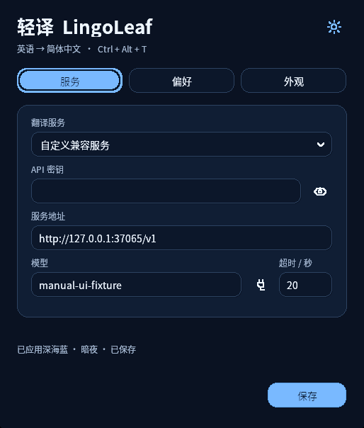
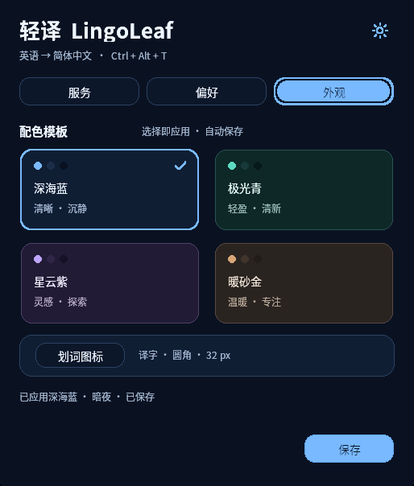
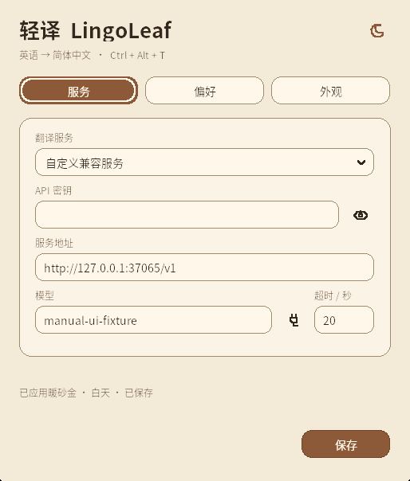
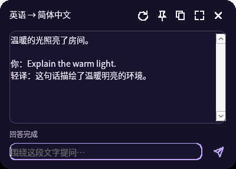

# 0.8.0 构建验证记录

日期：2026-11-07。开发分支：`lingoleaf`。本轮为圆角界面与配色模板更新；旧版本记录可在对应 Git 标签查看。本文件将已完成检查与待验证项目分开，发行包保留打包时的记录，公开分发结果在发布后补记。

环境：Debian 13、Rust 1.99.1、Windows GNU 交叉工具链、Wine 10 / Xvfb。目标平台为 Windows 11 x64，原生 CI 使用 MSVC 静态 CRT；Wine 视觉效果与非交互 CI 均不代替 Windows / Edge 桌面实机验收。

| 检查 | 当前结果 |
|---|---|
| Linux 全 targets 单测 | 62/62 通过 |
| Rust fmt；Linux / Windows GNU 全 targets Clippy `-D warnings` | 通过 |
| Windows GNU release | 构建通过 |
| Windows GNU 全 targets 测试编译 / 链接 | `--no-run` 通过，不当作测试已运行 |
| 发行工具与版本一致性 | Python 14/14、版本检查通过 |
| Wine Windows lib | 139 通过、0 失败、1 项明确过滤；10.798 秒 |
| 最终 GNU 设置 UI | 通过；8.780 秒；八组合、草稿隔离、重启及原生控件 |
| 连续选区 / 问答 / 真编辑框菜单 | 18 次本地 POST 通过；8.542 秒 |
| 更新 helper | 0.8.1 固定夹具替换 / ACK / 精确回滚通过；7.339 秒 |
| 原生 Windows 全部测试、MSVC 构建与打包 | [分支 CI 通过](https://github.com/xiaoxiaoawei/test-hub/actions/runs/42335919329)；最终标签待核验 |
| 正式公开资产与旧版升级 | 待发布后核验 |
| Windows 11 系统圆角、混合 DPI 与 Edge 实机 | 未执行 |

## 本地候选与界面初测

当前最终 GNU 候选为 **866304 字节**，SHA-256：

```text
008fa517e652b837e47305d9d0c7c088997f6e79f3ea37440b19d4d18dc37912
```

这是本地交叉构建文件的标识；CI 的 MSVC 文件由独立工具链生成，应使用其发行清单与 `SHA256SUMS`，不能混用哈希。下文分别记录截图、最终测试与公开分发；公开 MSVC 文件大小在发布后补齐。

最终 `008f…` 字节的扩展设置回归已通过：

- 四套模板各自暗夜 / 白天，共八种组合，实际读取 GDI 背景像素验证颜色切换。
- 原生下拉箭头的真实鼠标点击与 Home / Enter 选择可用。
- 模板切换即时保存，不提交未保存的 API、模型、超时或语言草稿。
- 旧配置迁移为暖砂金且原有明暗保留；模板保存后重启恢复。
- 密钥显隐、三页切换、成功提示、外观子窗口与原有设置回归通过；托盘退出正常。

## 实际界面与鼠标检查

同版 `809e…` 界面预检已逐张检查四套模板、米黄色白天与图标子窗口，表单、卡片和文字没有裁剪，下拉白边已消失。随后最终 `008f…` 调整折叠下拉的绘制顺序，避免键盘换项临时覆盖箭头背景；最终自动回归通过，四张截图也用最终字节重新拍摄。

实际鼠标点击与 40 次模板切换正常；Tab / Shift+Tab 在模板卡片间移动，Space 能选择并保存。Wine 的圆角降级窗口区域为复杂区域，角点在区域外、中心在区域内；不把这当作 Windows 11 DWM 结果。该环境的 `GetGuiResources` 返回未实现，未据此宣称 GDI 数量稳定。

使用真实鼠标拖选原生文本窗口的 31 个字符，随后点击小框、键盘输入问题并按 Enter，本地 SSE 译文与问答完整呈现，两次请求均无认证头。此项未注入应用的选区完成消息，也未调用付费 API。

以下是最终 `008f…` 字节的真实 Wine 客户区截图：已排除兼容层原生标题栏字形差异，窗口内容未重绘或伪造；只读文本的系统滚动条在 Wine 中可能保持浅色。









## 最终回归范围

本轮已核对三页切换、四张模板卡片、圆角输入框 / 下拉 / 按钮 / 浮框、鼠标点击与键盘焦点，以及反复切换后的实际重绘。资源数量的兼容层限制如上所述。Windows 11 DWM 圆角与 Windows 10 / Wine 的降级处理分别记录，截图不能证明所有系统外框效果一致。

最终字节的 18 次本地请求回归已通过停止 / 重译、问答草稿、流式选区与滚动位置、保持显示、临时暂停、语言、原生译文右键复制及旧响应隔离。旧响应 body 门闩仍关闭时，后继请求已完成。更新 helper 用随机临时目录中的父 EXE 副本与固定 0.8.1 夹具，成功分支替换、收到启动确认并清理备份；未确认分支精确恢复旧 SHA 并重启，未覆盖交付文件、未发送网络请求。

### Wine 的已知网络测试边界

Wine 的 WinHTTP 在已缓冲 HTTP chunk 尾部、下一 chunk header 尚未到达时，异步 `ReadData` 调用自身可能同步阻塞。测试 `translation::winhttp::tests::winhttp_cancels_a_stalled_sse_body_and_reuses_the_client` 在源码中正常启用；原生 Windows CI 必须不忽略、不自动跳过地运行。

Wine 回归仅允许显式过滤该已定位的单项，并记录实际通过 / 过滤数量，不能称作全套通过。界面模拟服务可使用合法 Content-Length SSE，旧响应 body 的门闩仍须保持关闭，直到新请求完成；不能放开旧响应来伪造取消效果，也不能用该响应格式替代原生 Windows 的 chunked 边界测试。本轮 Wine 实际结果为 139 通过、0 失败、1 项显式过滤；原生 Windows 分支 CI 的完整测试不含过滤参数，已通过这一 chunked 边界。最终标签也须同样通过。

## 分发与验证边界

主文件仍为 `lingoleaf.exe` 和 `lingoleaf-windows-x64.zip`；版本化 EXE 仅作旧更新器兼容副本，必须与主 EXE 字节相同。`update.json` 保持 schema 1 六字段与兼容地址，`SHA256SUMS` 覆盖四个 payload。正式发布后需实际读取固定 latest 清单、下载五项资产、检查哈希和 ZIP，并用旧客户端验证替换、启动与配置保留；仅标签页面 HTTP 200 不代表更新可用。

本轮测试不使用真实翻译密钥，不调用付费翻译服务。模拟回复不代表真实模型的速度、语义质量或费用。扫描 PDF / 图片仍无 OCR；浏览器取词、剪贴板恢复、真实 Windows 焦点与多屏行为须按 [验证清单](windows-validation.md) 分别验收。
