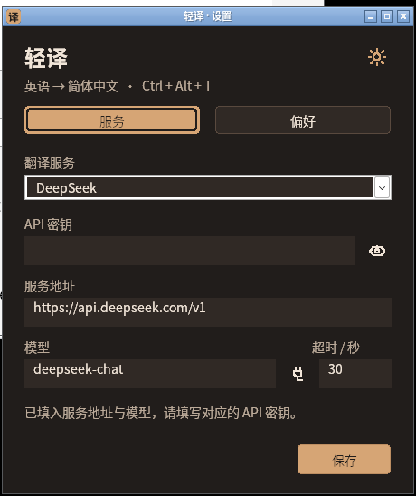
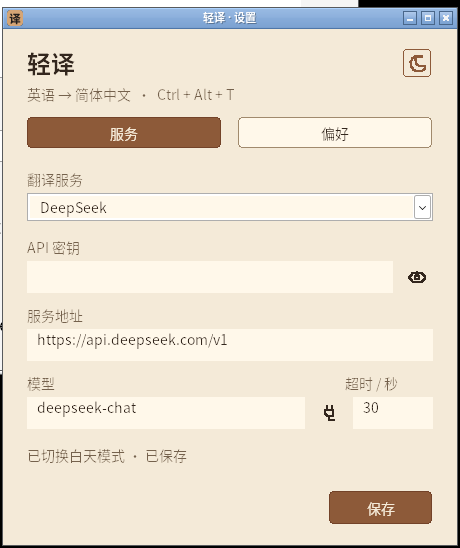
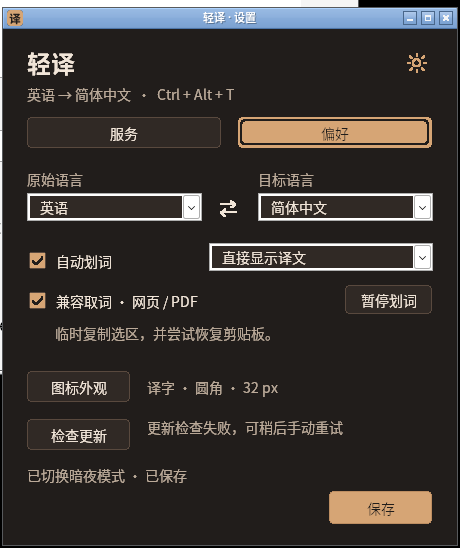

# 0.7.1 构建验证记录

日期：2026-11-07。开发分支：`lingoleaf`。本记录区分 Linux、Windows 原生 CI、Wine 兼容层与公开更新源；发行包保留发布前验证，公开下载与升级结果已在末尾补记。0.6.0 历史记录保留在对应 Git 标签。

环境：Debian 13、Rust 1.99.1、Windows GNU 交叉工具链、Wine 10 / Xvfb。目标为 Windows 11 x64，另有 Windows runner 的 MSVC 静态 CRT 构建；Wine 不能代替 Edge 或 Windows 桌面实机验收。

| 检查 | 当前结果 |
|---|---|
| Linux 全 targets 单测 | 57/57 通过 |
| Rust fmt；Linux / Windows GNU 全 targets Clippy `-D warnings` | 通过 |
| Windows GNU release、全 targets 测试编译 / 链接 | 通过 |
| 发行工具、稳定文件名与旧更新协议兼容测试 | Python 14/14 通过 |
| 原生 Windows 全部测试、Clippy、MSVC 构建与打包 | [分支 CI 通过](https://github.com/xiaoxiaoawei/test-hub/actions/runs/42329914382)，含 stalled SSE 取消测试，无过滤 |
| 最终 Wine lib | 134 通过、0 失败、1 项明确过滤；10.23 秒 |
| 最终 Wine 设置回归 | 0.7.1 通过；6.21 秒；显隐、交换、暂停、保存、主题与原有外观 |
| 连续选区 / 问答 / 交互控制 | 0.7.1 真编辑框菜单、18 次本地 POST 全通过；8.46 秒 |
| 更新 helper | 0.7.1 使用 0.7.2 夹具的隔离替换 / 启动确认 / 失败回滚通过；7.25 秒 |
| 正式发行资产与旧版升级 | 0.7.1 公开清单与 4 payload 校验通过，旧 0.6.0 升级正式 MSVC 版本成功 |

## 取消与内存安全

翻译和问答保持各自独立工作线程，WinHTTP 会话改为异步请求。等待时使用条件变量并检查取消和整体截止时间；取消由工作线程关闭自己的请求，不再等待最终关闭通知才处理下一选区。

请求头、请求体和读缓冲区由回调注册 Arc 保留到最终 HANDLE_CLOSING；每次回调也持独立引用，构造失败回收注册引用。每客户端最多 16 个存活请求；取消关闭迟到或失败时不会无界积累缓冲区。测试覆盖无请求发送的关闭、构造失败、上限拒绝及关闭后的槽位回收。

独立网络模块的 Wine 测试已确认：首包阻塞取消约 9.57 ms，同客户端下一请求在旧服务的门闩仍关闭时完成；旧服务结束后活跃槽位回到 0。整体 1 秒截止、普通 JSON、SSE 增量显示、连接复用、问答上下文与安全错误处理通过。

Wine 的 WinHTTP 在“已缓冲 chunk 的末尾，但下一 chunk header 尚未到达”时，异步 ReadData 调用自身仍可能同步阻塞。测试 `winhttp_cancels_a_stalled_sse_body_and_reuses_the_client` 在源码中正常启用，原生 Windows CI 必须实际通过；本地 Wine 回归仅显式过滤这一项，不能将其说成全套通过。原生 Windows 分支 CI 已在不忽略、不自动跳过该测试的情况下通过完整测试，证实真正 chunked SSE 阻塞取消和同客户端继续请求。没有引入生产环境绕过或为兼容层牺牲增量显示。

## 交互与分发

本轮关注：停止 / 强制重新翻译、停止回答及失败保留草稿、流式选区与上翻位置、保持显示、临时暂停、语言交换、密钥显隐、标题拖动及右键复制。最终本地候选为 838656 字节，SHA-256 `f003021cd6e96d59fb1431c7ce0b81aab141c87a6c513b8ea1928eace5110332`。扩展设置回归已通过；后续用同一字节继续验证选区、问答及 helper，不与 CI 生成的 MSVC 文件混用哈希。

主文件为 `lingoleaf.exe`、`lingoleaf-windows-x64.zip`；版本化 EXE 是与主 EXE 字节完全相同的旧协议兼容副本。update.json 保持六字段 schema 1 与旧 URL，0.5.0 / 0.6.0 可继续升级；新客户端只额外允许本仓库同标签精确稳定名称。5 项发行资产中 4 个 payload 的哈希列在 SHA256SUMS。

所有网络测试只使用本机公开测试夹具和空 / 假密钥；未调用真实 DeepSeek，不能以模拟结果代表真实模型速度、翻译质量或费用。扫描 PDF / 图片仍不提供 OCR。Windows 的混合 DPI、多屏、实际桌面焦点和 Edge 网页 / PDF 验收仍按验证清单进行。

### 18 次本地请求的交互回归

扩展 `examples/selection_smoke.rs` 保留原先选区 / generation / 缓存检查，并校验：回答 503 后恢复原问题且可重试，停止时保留已显示片段和新草稿，取消或失败轮次不进入后续上下文；旧响应 body 门闩仍关闭时，下一译文与下一问答已完成。

翻译停止后保留部分内容，手动重新翻译实际发出新请求并绕过缓存；HTTP 失败可重试。保持显示后跨前台仍可读，下一次有效划词仍更新原 HWND 和位置；暂停自动划词不会发出自动请求，但手动翻译剪贴板继续工作。长流输出保留 EM_GETSEL 的 0..6 选区和首行滚动位置。原生右键菜单打开期间完成请求，关闭菜单后仍正确处理队列并显示完成。

这套 Wine UI 服务使用合法的 Content-Length SSE 响应，整个延迟 body 仍保持未发送；没有放开旧响应门闩来假装取消成功。Wine 在 chunk header 边界的阻塞差异由前述原生 Windows chunked 测试独立覆盖；不以 UI 服务的响应格式规避 Windows 必须通过的传输边界。

设置回归还确认：密钥显隐只影响显示、不保存草稿；交换语言仍需保存且 Auto 源不可交换；暂停不落盘、重新启动恢复；保存提示、主题、子窗口居中及图标原有功能继续通过。空闲设置窗口在 2 秒观测中 CPU 增量 0.0000 秒。

### 实际鼠标操作

最终字节的标题区真实拖动使小框从 `(398,192)` 移到 `(598,352)`，未增加网络请求。真实 Pin 点击后切换到另一软件仍可见；随后打开 / 关闭设置，真实取消保持，再切到另一软件，小框在 500 ms 内自动隐藏。该回归覆盖设置操作取消 watcher 后，取消保持必须恢复 watcher 的边界修复。

更新 helper 只使用随机临时目录中的父进程副本和 0.7.1 固定测试 EXE，未向外网请求、未覆盖交付 EXE；成功分支收到启动确认并清理备份，失败分支精确恢复旧 SHA 并重启。

### 本版截图

以下为最终候选的空密钥界面。截图来自 Wine，系统外框和原生控件与 Windows 11 可能不同，更新联网状态也受该测试环境影响。

## 0.7.1 右键路由修复

实际鼠标验证发现 0.7.0 的文字编辑框自行显示系统菜单，父窗口未收到 WM_CONTEXTMENU；复制图标的右键入口已正常，但编辑区入口与说明不一致。0.7.1 使用只针对两个只读译文编辑框的原生 subclass 转发右键消息，销毁时移除回调，其他原生编辑行为保留。不移动或覆盖已经推送的 0.7.0 标签与发行资产。

下文发布后记录与最终候选哈希以 0.7.1 的实际验证为准；上文 f003 候选和分支 CI 为 0.7.0 功能基线。

0.7.1 本地 GNU 候选为 839168 字节，SHA-256 `4b9c61a2a004ccec0cf88154542dfb3fa3a84ff688d58fd33cf25a80adf0b8da`。两个译文编辑框（小框 251、详情 224）和复制图标三处均通过真实鼠标右键 / 第三项复制验证，剪贴板包含完整问题与回答；不将向父窗口注入消息当作实际编辑框菜单路由的证据。

0.7.1 永久回归已改为向译文编辑框本身请求右键菜单，菜单 API 可读时断言三项；Wine 菜单信息 API 不可读时，实际执行 Home → Down → Enter，验证复制整段译文且原 0..6 文字选区与首行滚动位置不变。旧默认菜单该操作会变成“全选”，无法通过此语义断言。菜单期间请求完成、菜单关闭后队列继续处理的检查也保留。

0.7.1 最终字节的设置 6.21 秒、18 请求与真编辑框菜单 8.46 秒、0.7.2 helper 替换 / ACK / 精确回滚 7.25 秒均通过。已完成格式、Windows 全 targets 严格 Clippy、14 项打包测试、版本一致性检查；正式 Windows 标签 CI 与公开分发结果在发布后补记。

## 0.7.1 正式公开分发

源码提交 `53f8752`、标签 `v0.7.1` 的 [原生 Windows / Linux / 发布流水线](https://github.com/xiaoxiaoawei/test-hub/actions/runs/42332348604) 三项任务均成功；原生 Windows 的完整测试不包含 Wine 的过滤参数，stalled chunked SSE 取消用例正常执行并通过。

已实际匿名下载公开的 `lingoleaf.exe`、`lingoleaf-windows-x64.zip`、版本化兼容 EXE、SHA256SUMS、固定 latest 更新清单。四个 payload 的 SHA 全部通过，主 EXE 与兼容副本逐字节相同，ZIP CRC 完整且其中 EXE 与公开独立文件一致。ZIP 为 25 项明确允许的条目，不含配置、日志、测试 DLL、浏览器或私有数据。

正式 MSVC EXE 为 819712 字节（不到 1 MiB），SHA-256 `4f741d0862e4387b0f7eea75f1d6390e7fe0a410ff4b2a16495ce6f1a9fce9d6`。文件为 x64 GUI，仅依赖系统 DLL；它由独立工具链生成，不能拿本地 GNU 哈希混用。固定更新清单实际为 0.7.1、schema 1 六字段和对应版本兼容 EXE 地址，面向用户的主下载名始终为 `lingoleaf.exe`。

### 网页与 PDF 实际划选

在 Wine 10 / Xvfb 中运行真实 Windows Chromium 103 / PDFium，使用最终 0.7.1 GNU 候选进行真实鼠标拖选。网页原文 `The quick brown fox jumps over the lazy dog.` 和文本 PDF 第 1 页 `Dynamic languages` 各发出一次精确原文的本地请求，均无认证头，界面显示完整中文模拟译文。

该测试主动开启兼容取词，网页和 PDF 两次临时复制后，原 Unicode 与 HTML 剪贴板 marker 均逐字节恢复。PDF 夹具 SHA-256 为 `3662ff519e485810520552bf301d8c3b2b917fd2f83303f4965d7abed367e113`。这验证当前浏览器 / PDFium 路径，不冒充 Edge 或 Windows 桌面实机结果，也不代表真实模型速度或质量。

### 旧 0.6.0 升级正式 0.7.1

使用原始已公开的 0.6.0 MSVC EXE 与隔离 LOCALAPPDATA，旧 GUI 成功发现正式 0.7.1，确认下载、生产校验、确认重启后旧进程正常退出，新 MSVC 设置页实际可见并显示“v0.7.1 · 已是最新版本”。目标文件为公开的 819712 字节 / SHA-256 `4f741d0862e4387b0f7eea75f1d6390e7fe0a410ff4b2a16495ce6f1a9fce9d6`；原 settings.json 逐字节保留，GUI 核对源 Auto、目标日语、37 秒超时、Direct、兼容取词、Light 和字母 A / 圆形 / 48 px 均保留；AppReady 后备份和安装票据均为 0。

此项是在 Wine 中本地传输回放实际公开的原始清单和正式 MSVC 字节，不改版本、URL、大小、哈希或生产 guard；旧 feed、正式兼容资产、新 feed 三条 GET 均无认证头。测试 DLL 仅为了更新回放，新增异步回调符号只供 loader 解析，若误调用会失败而不伪造翻译成功；实际升级流程未调用该符号。公开网络下载另由匿名 HTTPS 实际验证，不把本地回放冒充目标 Windows 机器的 GitHub 联通。

正式程序和公开资产没有为测试修改或重写；测试 EXE、DLL、配置、浏览器、日志均未打入发行包。主下载仍为不带版本号的 `lingoleaf.exe`，已发布资产保持不覆盖。
