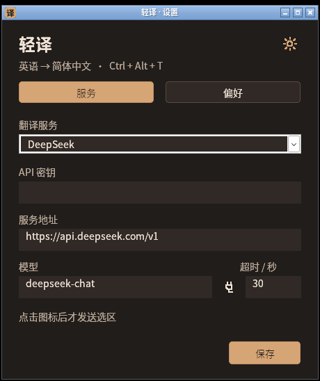
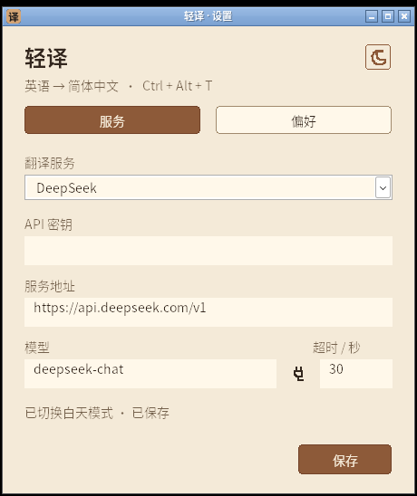
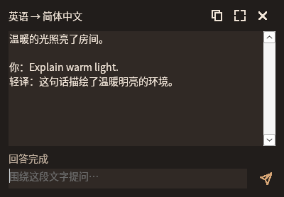

# 0.6.0 构建验证记录

日期：2026-11-05。分支：`lingoleaf`。本文件前半记录发布前检查，末尾补记实际公开分发与升级验证。发行包内的同名文件保留发布前记录，发布资产不被覆盖。历史 0.5.0 记录可在对应 Git 标签的同名文件查看。

环境：Debian 13 x64、Rust 1.99.1、MinGW-w64、Wine 10 / Xvfb。交付流水线另使用原生 Windows runner、MSVC 和静态 CRT。Wine 的界面操作测试不等同于 Windows 桌面或 Edge 实机验收。

| 检查 | 结果 |
|---|---|
| Rust fmt；Linux / Windows GNU 全 targets Clippy `-D warnings` | 通过 |
| Linux 全 targets 测试 | 56 项通过，0 失败 |
| Windows GNU 全 targets 测试编译与链接 | 通过 |
| Windows lib 测试，在 Wine 运行 | 125 项通过，0 失败 |
| 原生 UI smoke，在 Wine 运行 | 通过；含旧配置、语言、两页设置、主题、保存、外观子窗口 |
| 连续选区 / 七次本地 POST / 多轮问答隔离 smoke | 通过；6.74 秒 |
| 更新 helper 隔离副本 smoke | 通过；5.94 秒；成功安装与失败回滚 |
| 真实鼠标拖选与键盘提问 | 通过；点击输入框、Unicode 输入、Enter 提交 |
| 版本与打包工具 | 12 项通过；Cargo、锁文件、资源、更新记录与 `v0.6.0` 一致 |
| Windows GNU release | 824320 字节，Windows x64 GUI；仅导入系统 DLL |

本地测试候选 SHA-256：`7c7d0ad9678e8c2ccf7466cb9237f34e4ae32718094c16a4b23520831bd9cd70`。CI 的 MSVC 文件由独立工具链生成，必须使用对应发行资产的 `SHA256SUMS`，不能混用本地 GNU 哈希。

## 设置与语言

扩展 `examples/ui_smoke.rs` 使用隔离的当前用户配置目录，覆盖首次启动居中、保存后重启、重复运行激活同一实例、草稿保留、原生保存成功提示、日夜主题像素与持久化。

旧版缺少语言字段的配置仍为英语 → 简体中文。测试切换为自动检测 → 日语，核对保存、关闭重开、重启及更换服务预设后的值；主题或图标应用不会提交未保存的 API 草稿，也不丢失已保存的语言。两页中的非当前控件实际隐藏。

外观窗口从偏好设置的真实按钮进入，验证 owner 为设置页、设置页在子窗口打开时禁用、子窗口在设置页上方居中，关闭后设置页恢复。图标形状、尺寸、颜色与原有回归继续执行。

## 翻译与问答

网络测试只使用本机模拟 SSE 服务和固定公开测试文本，不使用聊天中的密钥，不调用真实翻译服务，不产生翻译 API 费用。模拟回复不代表模型质量或真实服务延迟。

翻译和问答使用不同工作线程；问答请求包含当前原文、译文、最近的成功问答及本次问题。源/目标语言进入实际请求指令；缓存按语言对隔离，问答不使用翻译缓存。每次物理新选区、手动取词或语义配置变化都会使旧问答结果失效，包含相同单词在另一位置重新划选的情况。

`examples/selection_smoke.rs` 校验同一个小框 HWND、连续选区位置变化、同词 in-flight / 缓存复用，以及空选区和密码字段不产生网络请求。七个本地 POST 分别为三个翻译和四个问题：第二问包含第一轮问答，旧回答阻塞时新选区翻译仍能完成，旧回答释放后不会覆盖新内容，新问题不包含旧选区历史。

独立实际输入测试用真实鼠标拖选原生 EDIT 文本，再点击提问输入框，通过 SendInput 输入 Unicode 问题并按 Enter。核对前台窗口与 focus=260、完整答案、状态及完成后仍可用的输入 / 发送按钮。提问自动化先真实激活输入框，按 Windows 控件习惯统一比较 CRLF；不把后台 BM_CLICK 当作真实输入焦点测试。

## 更新分发与安装

固定地址：`https://github.com/xiaoxiaoawei/test-hub/releases/latest/download/update.json`。更新协议保持 schema 1 和原有六字段，`src/update.rs` 与更新网络模块保持 v0.5.0 的协议，可由已有更新按钮发现 v0.6.0。只接受本仓库、稳定版本、对应标签及 EXE 名称；检查和下载不携带翻译密钥或选区。

发布流水线先运行原生 Windows / Linux 检查，校验 MSVC EXE 的 FileVersion / ProductVersion，生成 EXE、ZIP、SHA256SUMS、update.json，再发布。此次 v0.6.0 获准正式公开并设为 latest；其他标签默认仍为草稿。只有实际公开的 Release 资产进入客户端更新源，标签页面 HTTP 200 本身不证明资产已公开。

下载与替换继续核对精确大小、SHA-256、PE32+ x64 GUI / 非 DLL 与嵌入版本。更新 helper 的隔离测试使用版本 0.6.1 的本地测试 EXE；它们不会进入发行包或公开发布，也不会覆盖交付 EXE。成功分支确认父进程退出、替换、启动确认和备份清理；失败分支恢复原文件并重启。

## 验证边界

- CI 的 Windows 单测和构建不等同于交互式桌面验收；真实 Windows 的混合 DPI、多屏负坐标、Edge 网页 / PDF、目录权限失败及实际重启体验仍需按验证清单检查。
- 当前浏览器取词路径沿用 0.4.2，未把早前 Chromium 103 / PDFium 在 Wine 下的结果当作本轮 Edge 验收。
- Wine 部分原生标题栏与 MessageBox 正文有 CJK 字体回退限制，测试通过 API 核对 Unicode 正文、按钮与所属关系；主页面中文绘制正常。
- 尚未使用真实 DeepSeek 测量延迟、翻译质量或费用。程序无 OCR，不能读取扫描 PDF 中仅有的图片文字。
- 当前产物未签名，无安装器或后台静默升级服务。下载和重启仍由客户端用户确认；已保存配置留在当前用户目录，密钥继续 DPAPI 保护。

## 发布后公开核验

源码提交 `ea9ab08`，标签 `v0.6.0`。原生 Windows x64、Linux 逻辑测试与正式发布三个任务均成功：[标签流水线](https://github.com/xiaoxiaoawei/test-hub/actions/runs/42005407327)。Windows 任务包含全 targets 测试、严格 Clippy、MSVC 静态 CRT 构建、嵌入版本验证和打包。

[正式发行页](https://github.com/xiaoxiaoawei/test-hub/releases/tag/v0.6.0) 已公开，含 EXE、ZIP、SHA256SUMS、update.json 四项资产。匿名请求固定 `releases/latest/download/update.json` 实际 HTTP 200，返回版本 `0.6.0`、schema 1、原六字段及本仓库对应版本 EXE 地址。

已实际下载公开 EXE、ZIP、SHA256SUMS 和 latest 清单，三项 SHA 校验全部通过；EXE 大小 806400 字节，SHA-256 为 `750ba74bc13479c724512550c5172cace0ad43500a836f2356aff598cd7c0287`。PE 为 Windows x64 GUI，ZIP 内 EXE 字节与公开独立 EXE 完全一致，22 项打包条目无测试 DLL、配置或日志。

### 旧版客户端升级正式资产

另以原始 0.5.0 EXE（780800 字节，SHA-256 `987117663b90f8d08a770f7b2187a938436e65b191df28c454d4bbb9500eefb8`）在随机隔离目录完成 GUI 更新流程。网络替身只回放前述实际公开的原始清单和 MSVC EXE 字节，不改 URL、版本、大小或哈希，也不绕过生产校验。

旧 GUI 成功发现 0.6.0、下载并校验正式 806400 字节 EXE；确认重启后旧进程正常退出，目标文件 SHA 与公开 MSVC 资产一致。正式新版设置页实际启动并显示 Light 主题及“v0.6.0 · 已是最新版本”。原 settings.json 逐字节保留；UI 核对本地服务地址、模型、37 秒超时、Light、Direct、兼容取词以及字母 A / 圆形 / 48 px 外观均保留，旧配置缺失语言字段正确迁移为英语 → 简体中文。备份和安装票据被清理，证明正式 AppReady 启动确认路径成功。

测试首次执行时仅测试用网络 DLL 未随 helper 的工作目录切换而被 Wine 找到，助手未就绪且旧程序保持运行；将同一个测试 DLL 放在隔离 helper 目录后，真实同版客户端重试成功。未修改任何生产程序、清单、校验守卫或公开资产。此项证明旧客户端与正式资产的安装兼容性；目标 Windows 机器到 GitHub 的 WinHTTP 网络、系统权限和实际桌面体验仍受其运行环境影响。

实际鼠标补充检查：Space 可切换并保存 Dark / Light，Tab 会跳过隐藏页；外观窗口 Esc 后设置页重新启用，焦点回到外观按钮；悬停主题图标出现原生提示“切换白天 / 暗夜”，复制和测试模型连接也已注册对应提示。所有截图和测试都没有使用真实翻译密钥。
