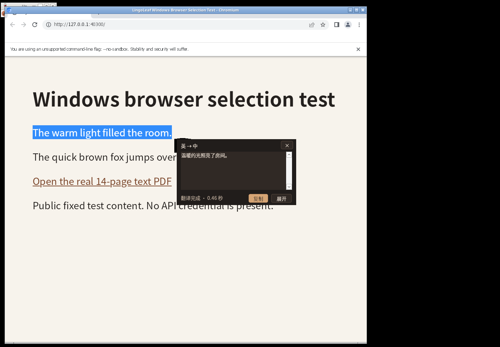
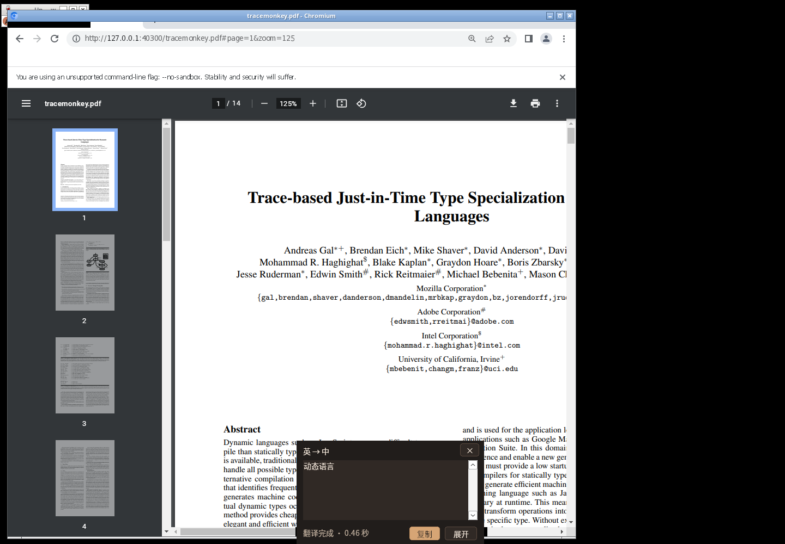

# 0.4.2 构建验证记录

日期：2026-11-05。开发分支：`lingoleaf`。本记录区分 Linux 构建、Wine 兼容层、实际 Windows 浏览器程序和 Windows 实机；未完成项目不视为通过。

构建环境：Debian 13 x64、Rust 1.99.1、MinGW-w64、Wine 10，目标 `x86_64-pc-windows-gnu` GUI EXE。远端 Actions 未核验；本地通过不表示 Windows MSVC CI 已通过。

| 检查 | 结果 |
|---|---|
| Rust fmt / Linux 与 Windows GNU Clippy `-D warnings` | 通过 |
| Linux 全部 targets 单测 | 40 项通过，0 失败 |
| Windows 全部 targets 测试编译、链接 | 通过 |
| 最终 Windows lib 测试在 Wine 中执行 | 98 项通过，0 失败，约 10.24 秒 |
| 原生 UI smoke（含兼容选项） | 通过：默认关闭、真实点击保存、预设/外观保持、重启恢复；静置 CPU 增量 0.0000 秒；零 API |
| 连续划词控制器 smoke | 通过：同框、位置、旧进度隔离、在途与缓存去重、空选区/密码；2 个本地 POST |
| 版本与打包脚本 | 7 项测试通过；Cargo、资源、更新记录与 `v0.4.2` 一致 |
| Windows x64 release | 构建通过，无新增第三方运行时依赖 |

## 读取路径与兼容取词

修正了可在代码中确认的问题：原先遇到已证明归属的子 HWND 就停止祖先搜索，可能错过上方的文档模式；不相关的子节点可能先耗尽文档搜索预算。当前继续有界祖先搜索，优先命中内容区域预热，分别限制扫描与有效候选，且文档/Text 候选不单凭缓存的模式可用性判断就放弃探测。缓存显式采用 Raw View 条件。上述修正不等同于已证实 Edge 实机问题的根因。

新增的 `compatibility_capture` 默认及旧配置均为 `false`。只有用户勾选并保存、明确物理划选、只读取词失败、来源为已验证的浏览器正文/PDF 时，才允许一次临时复制；普通点击、工具栏、密码或无法确认安全属性的控件不扩大为通用复制。UIA 完全不可用时，已知正文原生子窗口可提供有限的来源证明，整个浏览器根窗口本身不能作为证明。

复制回退先预分配并快照全部受支持格式，再发送输入。支持系统合成文本格式、HTML、RTF、PNG、DIB 等；DIB 的合成位图由 Windows 重建。未知私有格式和不能完整恢复的 GDI/OLE 数据拒绝操作。按复制前序号、前台、来源进程和输入变化判断是否可读取或恢复；未观察到新复制时不能读取旧剪贴板作为选区。键盘观察忽略本模块带标记的注入，其他输入会取消。新手势的 generation 原子通知捕获线程；复制前序号过期允许有限重试，只有实际注入才消耗本次划选的兼容机会。

Windows 原生剪贴板测试覆盖空内容、Unicode 合成格式、HTML+Unicode、多格式/DIB、未知格式拒绝、序号与取消、真正返回新文字并恢复旧内容，以及无效新 UTF-16 仍恢复旧内容。独立模块先通过 9 项 Wine 测试，再新增成功与无效 UTF-16 两项，最终全部执行结果以上表为准。快捷键原有受限复制回退也统一到此后端。

## 真实浏览器与网页 PDF

用户报告的浏览器为 Edge。实际执行的运行尝试与通过结果必须分开记录：

| 程序 / 场景 | 实际结果 |
|---|---|
| Windows Edge x64 官方安装包 | `https://aka.ms/edge-msi` 跳转成功，实际下载 CDN `msedge.sf.dl.delivery.mp.microsoft.com` 被当前代理策略返回 403，无法安装；未绕过策略 |
| Windows Chrome 157 官方离线包 | 下载、解包、manifest SHA 校验成功；Wine 中正常及针对性禁图形合成启动均退出，无可用窗口；未完成网页/PDF 测试 |
| Windows Firefox 125.0.3 Portapps | 发布包 SHA-256 一致；出现 Windows 窗口并请求 HTTP 页面，但正文白屏，内容/GPU IPC 异常；禁 GPU/Direct2D 后仍无可复制正文，未通过 |
| Windows Chromium 103.0.5060.114（Portapps，Wine） | 实际渲染 HTML；启用兼容取词后，Click / Direct 的选区、请求与小框显示通过；内置 PDFium 打开 HTTP 文本 PDF，真实选区翻译链路通过 |

Windows Chromium 103 测试使用本地 HTTP 网页和公开的 14 页文本 PDF，翻译服务为本地 SSE mock；没有 API Key，没有认证头，也没有真实 DeepSeek 调用。网页是测试用 HTML，PDF 为 Mozilla PDF.js 仓库的 [tracemonkey.pdf](https://github.com/mozilla/pdf.js/blob/master/test/pdfs/tracemonkey.pdf)，SHA-256 为 `3662ff519e485810520552bf301d8c3b2b917fd2f83303f4965d7abed367e113`。浏览器为 Windows 程序，PDF 使用其原生 PDFium 阅读器；没有预提取 PDF 文字作为浏览器选区。

| 场景 | 实测结果 |
|---|---|
| 兼容选项关闭，浏览器 UIA 不可读 | 零 API 请求，未更改剪贴板 |
| Click：网页拖选整句 | 点击前零请求；点击图标后仅 1 个 POST，原文精确为 `The warm light filled the room.`，小框显示“温暖的光照亮了房间。” |
| Direct：网页改选另一句 | 自动 1 个 POST，原文精确为 `The quick brown fox jumps over the lazy dog.`，小框显示模拟中文结果 |
| 再次选择已完成的 warm 句子 | 命中缓存，没有新增 POST |
| 原生 PDFium，HTTP PDF，第 1/14 页，125% | 从 Abstract 实际拖选 `Dynamic languages`，自动 1 个 POST，原文准确，小框显示“动态语言” |
| 复制回退后检查旧数据 | 每次预置的 Unicode（76 字节）和 HTML（200 字节）均按字节恢复 |
| 来源检查 | 正文与 PDF 的命中窗口为 `Chrome_RenderWidgetHostHWND`，根为 `Chrome_WidgetWin_1`，未放宽为整个浏览器窗口 |

上述完整流程共 3 个本地 POST。Wine 批量注入未被外部计数钩子可靠观察到，因此不把“仅一次实际 Ctrl+C”列为独立端到端计数已通过；实现的注入标记、任务调度与后端测试另有覆盖。模拟服务的约 0.46 秒完成时间不代表真实 API 性能。

首轮完整流程后换用最终 EXE、清空进程内缓存，在相同原生 PDFium 页面再次真实拖选 `Dynamic languages`；新增 1 个 POST，原文与小框译文仍正确，Unicode/HTML 标记恢复。最终 EXE SHA-256：`0f0e26d27fcd0e65af633b94f0ba41517333672e94a5b32286e00721264d5444`。全部浏览器回归合计 4 个本地 POST，其中第 4 个用于最终候选复核。

截图为原始兼容层桌面记录。页面和窗口的实际外观、合成及 DPI 仍不能代替 Windows Edge 验收。

Wine 10 的 UI Automation client 存在 `GetCurrentPatternAs` / `GetCurrentPattern` / `GetCurrentPropertyValue` 未实现路径。传统 EDIT 快路径和模拟 COM 范围测试通过，不能证明浏览器 UIA 可用；Wine 浏览器失败同样不能直接推断 Windows Edge 失败。不得用 Linux Chromium 或下载到的 PDF 文字冒充 Windows EXE 的端到端取词结果。

## 仍需验证与边界

- Edge 普通网页与内置 PDF、当前 Chrome、长 PDF 首中末页、地址栏旧选区及跨屏混合 DPI，仍需 Windows 实机按 [验证清单](windows-validation.md) 执行。
- 自建 HTTP/SSE 测试服务只验证真实选区进入请求及显示链路，不证明真实 DeepSeek 延迟、语义质量或费用；测试不使用聊天中的密钥。
- 剪贴板恢复只针对当前内容，不能回滚系统历史、云同步或第三方监控已观察到的复制。源程序若在超时之后才执行已注入的复制，仍可能迟到更新剪贴板；延迟渲染的旧数据物化也没有通用硬超时。来源或用户输入已变化时优先保留新数据，不猜测恢复。
- UIA 同步外部调用可能超过软预算；网络同步取消也需等当前调用返回。界面线程不执行这些操作。
- 扫描 PDF、图片和禁止复制的内容没有通用取词保证，应用不含 OCR。README 保留的截图来自 0.4.0，不作为本版功能验收证据。

当前产物未签名，不含安装器或自动更新器。
