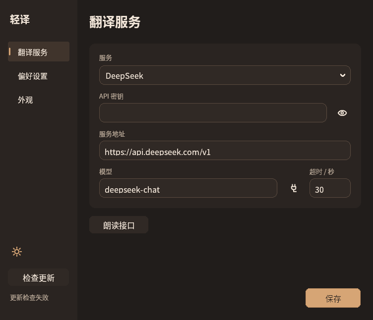
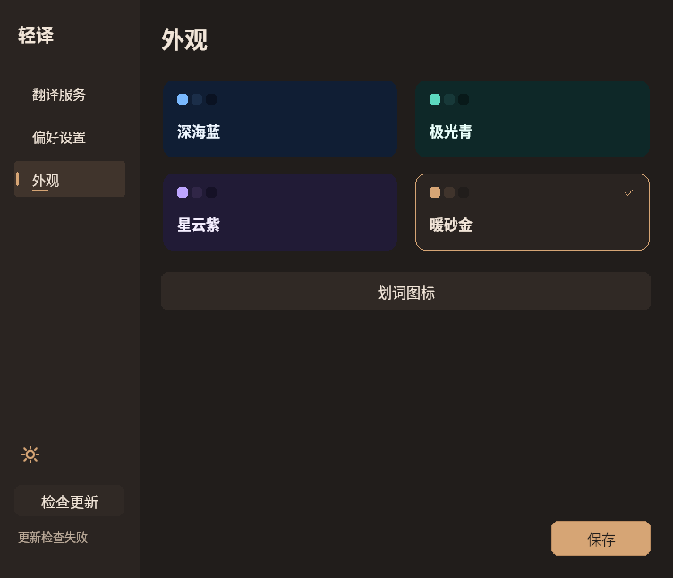
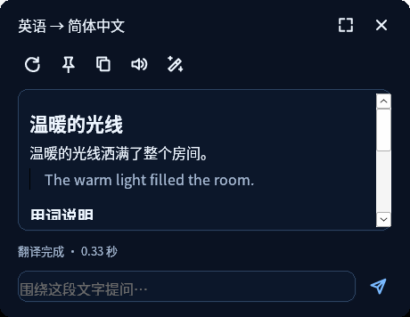

# 0.10.0 构建验证记录

日期：2026-11-07。分支：`lingoleaf`。本轮精简设置、固定翻译位置、修正圆角、增加手动快捷键与独立在线朗读。旧版记录保留在对应标签；本记录区分实际运行、原生 CI 与尚未完成的 Windows 桌面项目。发行包保留打包时记录，公开下载与旧版升级结果在发布后补记。

环境：Debian 13、Rust 1.99.1、Windows GNU 交叉工具链、Wine 10 / Xvfb；正式 CI 使用 Windows / MSVC 静态 CRT。未使用真实翻译或语音密钥，模型与音频请求使用 loopback 模拟服务。

| 检查 | 结果 |
|---|---|
| Linux 全 targets 测试 | 83/83 通过 |
| Linux / Windows GNU 全 targets 严格 Clippy | 通过 |
| Windows GNU release / 全 targets 测试编译 | 通过；编译不等于已运行 |
| 在线朗读纯模块 | 3/3 通过 |
| Windows 在线朗读传输与工作线程 | 独立 harness 6/6 通过，0.08 秒 |
| 发行工具与版本一致性 | Python 14/14、v0.10.0 元数据通过 |
| 三页设置 / 八种配色 / 可调整尺寸 / 手动热键 | 最终候选交互通过，约 11.49 秒，包括真实按键注册冲突与回滚 |
| 连续翻译位置 / 圆角 / Markdown / 润色 | 23 次本地模型 POST 通过（原 21 + 手动 2），约 10.61 秒 |
| 朗读首次配置与即时生效 | 模态零请求 / 取消 / 居中 / 独立密钥保存通过；3 次真实音频 HTTP |
| Windows lib / Wine | 首次无过滤 180 通过、1 项已知 Wine SSE 超时；精确过滤该一项后 180/180 通过，10.70 秒，原始失败日志保留 |
| 固定 150% / 200% DPI | 实际 144 / 192 DPI，字段 60 / 80 px，最小尺寸与真实滚动保存通过 |
| 更新 helper 成功 / 回滚 | 0.10.1 固定夹具替换 / AppReady / 精确回滚与重启通过 |
| 空白划选 | Direct / Click 共 8 负例零 Show / 零可见采样 / 零 POST；两例保持状态不变 |
| 原生 Windows 完整测试 / 构建 / 打包 | [v0.10.0 标签 CI 通过](https://github.com/xiaoxiaoawei/test-hub/actions/runs/42348692129)，完整无过滤；Linux 与发布任务也成功 |
| 实际公开更新源 / 旧 0.9.0 升级 | latest 实际 0.10.0；五资产 / 四 SHA / 13 项 ZIP 通过，旧版下载重启成功且配置逐字节保留 |
| Windows 11 DWM / Edge / 混合 DPI / 实际远端声音 | 未执行；兼容层不能代替实机结果 |

## 本版重点

设置只保留字段与操作，说明移到 tooltip；导航用背景和强调色表达选择与焦点，配色模板使用单层选中框。窗口最小 600 × 480 逻辑像素，可调整尺寸，窄窗口支持滚动。四套模板、明暗切换、16 / 13 DIP 字号与按 DPI 绘制的图标保留，详见 [设计说明](design-0.10.0.md)。

圆角按窗口类型选择 DWM 或一个软件区域，不同时叠加。GDI 独立原生探针证明 CreateRoundRectRgn 的右下边界不包含末坐标：extent 100 仅覆盖到 98，使用 width + 1 / height + 1 才覆盖到 99，同时四角仍排除；保留此必要偏移。内嵌框与详情框各自记住首次位置，连续选择、缓存和重新翻译不重置；用户拖动后沿用新位置，显式关闭才清除锚点。

默认图标为绿色真实叶片轮廓，白色叶脉、透明外部、无阴影。旧圆角 / 方形 / 圆形编号保持，叶形追加为第 4 项。只有缺少默认值标记且精确匹配旧出厂组合的图标在内存迁移，读取不写盘，自定义不覆盖。

手动翻译默认 Ctrl+Alt+Space，原文可编辑，普通 Enter 换行、Ctrl+Enter 或按钮提交；原 Ctrl+Alt+T 保留读取选区。手动期间暂停自动划词。保存热键发生冲突或落盘失败时恢复旧注册；打开设置不屏蔽手动流，显式捕获失败不覆盖手动草稿，变更服务取消旧流后显示已停止。

润色一次点击发一次请求，只要求完整目标语言译文，不列要点或解释。保留原译文、草稿与成功问答历史的隔离。模拟响应只能证明请求合同，不证明实际模型质量、速度或费用。

## 在线朗读

移除 SAPI，使用独立配置的 OpenAI 兼容 `/audio/speech`，请求仅含 model / input / voice / response_format=wav。独立密钥通过 DPAPI 加密，不借用翻译密钥；空地址不联网，首次点击打开配置。可以接入提供兼容协议的远端 Kokoro 等开源服务，不内置免费托管地址。

WAV 有界至 20 MiB，在内存校验 PCM 后通过 Windows waveOut 播放，不写临时音频，不捆绑模型。独立测试实际验证独立 Bearer、四字段 schema、WAV 解析、异常 MIME / 超限 / 重定向拒绝、latest-wins、stop，以及等待 headers 和已读部分 body 后取消。旧响应门闩保持关闭，新请求已完成，证明取消不靠放行旧请求。共享 WinHTTP 仅提升必要可见性，没有复制传输实现或修改 SSE 逻辑。

工作线程单独拥有音频句柄，以 CALLBACK_EVENT 非阻塞检查完成；停止和关闭不阻塞 UI。缺设备路径可以验证错误恢复，不能冒充已听到声音。实际远端兼容性、音色、语言、费用与音频硬件仍需 Windows 桌面验收。

## 保留回归与平台边界

Markdown 使用原生 RichEdit，检查实际字符格式、Unicode、多行代码和复制，不以去掉标记代替排版。原生复制换行继续使用 `\par`；保留选区与滚动，外图和链接不执行。空白手势在确认有效文字前不显示窗口，空白 / 零宽负例需观察 Show 事件与高频可见采样，防止只看最终隐藏漏掉闪现。

Wine WinHTTP 在某些 chunk header 边界可能同步阻塞。仅允许明确过滤 `translation::winhttp::tests::winhttp_cancels_a_stalled_sse_body_and_reuses_the_client`，不能称为全套通过；原生 Windows CI 必须无过滤执行。GUI 模拟服务使用合法 Content-Length SSE，在后继完成前不释放旧响应门闩。

主文件固定 `lingoleaf.exe`，ZIP 固定 `lingoleaf-windows-x64.zip`。版本化 EXE 仅为旧更新器兼容副本，字节必须相同。更新清单保持 schema 1 六字段，发布后须实际匿名下载五资产、验证四 payload SHA、ZIP 允许列表、内嵌版本，并用原始 0.9.0 做下载 / 校验 / 重启 / 配置逐字节保留回放。GitHub 页面可见不能单独证明更新可用。

## 当前候选交互结果

最终 GNU 候选为 1181696 字节，SHA-256 `ce6e0ea8fae0b67ac04470d2c0a3498830b457353164032c1e7d795615e64aff`，此标识不与后续 MSVC 正式资产混用。

实际界面测试验证启动 / 再次运行激活、600 × 480 / 820 × 720 / 940 × 800 窗口的字段与滚动保存、语言保存、密码显隐、模板即时应用和独立草稿。真实键盘从默认快捷键唤起，修改后旧键失效；测试线程占用另一个组合时保存失败、原配置字节不动且旧绑定可用，退出后两个使用过的绑定均释放。

连续翻译、重复选词、缓存与强制重新翻译严格比较同一 HWND 和完整 RECT。内嵌框原生区域为完整 460 × 356，四角均排除、最后四条边中心均包含，四边采样 COLORREF 都为 `1b1d21`，未见白边。Markdown 实际字符格式、原生菜单和多行复制、流式围栏、草稿与历史保留通过；润色请求精确符合只输出译文的短提示词，一次点击一次 POST。

首次朗读在未配置时零 HTTP 打开设置所属居中模态，密钥字段遮掩；取消不写盘且回到当前译文，另行保存测试接口与独立假密钥后立即生效。后续三个真实 loopback 音频请求验证旧 body 不放行时取消并完成新请求、合法 PCM 传输、坏 WAV 拒绝，没有额外模型 POST。当前 waveOut 实际返回“无法播放语音，请检查声音输出设备后重试”，记录为缺设备错误恢复，不记录实际发声。

手动框通过真实复制 / 粘贴、按钮提交、普通 Enter 换行、Ctrl+Enter 多行提交。自动手势不能覆盖编辑草稿；手动流期间打开设置和暂停划词，旧响应门闩关闭后再放行的尾部完整显示，关闭 / 重新唤起保留原文草稿。

## 固定 DPI 与原生 CI

隔离 Wine profile 实际报告系统 / 窗口 DPI 为 144 与 192，40 逻辑像素输入框分别为 60 与 80 物理像素。真实调整到最小 600 × 480 逻辑像素后，外框为 900 × 720 / 1200 × 960，WS_THICKFRAME 存在，WM_GETMINMAXINFO 返回一致最小值。两个 profile 都在滚动后真实鼠标保存成功、退出 0。跨进程 HFONT 元数据不可读，因此不记录字体光栅硬件结论；固定 DPI 不等同混合屏幕测试。


这是最终候选原始客户区截图；向下滚动后顶部部分字段离开视口属于正常滚动。无真实密钥。

生产源码提交 `d971670` 的 [分支 CI](https://github.com/xiaoxiaoawei/test-hub/actions/runs/42347968349) 已通过 Windows 完整无过滤测试、严格 Clippy、静态 CRT release、嵌入版本验证和打包；Linux 与打包工具检查也通过。先前 Wine 出现的单个 chunked SSE 边界超时在原生 Windows 测试中未复现。分支产物仍不等于公开更新；标签与公开源在发布后单独记录。

## 更新 helper

0.10.1 固定夹具用于临时父程序副本，约 8 秒完成成功与失败路径。成功时核对已验证的替换、AppReady 与备份清理；启动返回 43 的坏夹具触发恢复原 EXE 字节并真实重新启动。此测试不请求网络，也不把未来夹具当正式新版本；公开 0.9.0 → 实际 0.10.0 的验证须在标签发布后另做。

## 空白划选与真实点击

最终候选完整复核约 98.65 秒。Direct / Click 各覆盖行尾空白、空行、实际非空的纯空格选区和换行 / 零宽选区，每例 mouse-up 后持续至少 6500 ms，均零新 Show、零可见采样、零模型 POST。两种模式各自以真实选词校准：Direct 显示译文，Click 显示叶片且点击前不发送、真实点击后准确一次请求。两种模式的保持显示负例中，译文、会话、草稿和 RECT 全部不变。旧 eager-popup EXE 仍能复现，说明观察器能抓到闪现。测试源与输入为 Wine 原生控件 / SendInput，不冒充 Edge 实机结果。

首轮 Click 正控曾超时，失败目录和日志保留。定位为旧测试 driver 会在鼠标输入前强制 SetForegroundWindow(chip)，与 MA_NOACTIVATE 的真实点击不符，触发生产中的来源前台保护。原生对照记录显示：只强制激活后叶片隐藏、零 POST；重新真划词、校验 WindowFromPoint 命中当前进程叶片后直接 SendInput，原页面保持前台且准确一次完整翻译。修正临时 driver 后完整两模式套件通过，未修改或绕过生产保护。全部自有测试进程与服务已退出。

本版截图来自同一最终候选，未编辑像素。Wine 等宽字体缺少部分中文 / emoji 字形时可能显示方框；Unicode 原文、原生复制与码点的严格断言仍通过。这是兼容层字体环境限制，不作为 Windows 字体渲染已验收的证据。

## 拖动后的定位

另以真实 SendInput 14 步拖动标题，将 RECT 从 `[366,175,826,531]` 移到 `[686,255,1146,611]`。随后同词缓存划取保留拖动后的完整 RECT，强制重译的第二个 POST 仍保持；显式关闭后重新真实划取回到 `[366,175,826,531]`，建立新的初始锚点。没有注入选区完成消息，两个本地 POST，全部自有进程退出 0。








## 正式公开分发

标签 `v0.10.0` 对应源码 `a2cc568` 的 [完整流水线](https://github.com/xiaoxiaoawei/test-hub/actions/runs/42348692129) 全部成功。Windows 无过滤测试、严格 Clippy、静态 CRT release、嵌入版本、打包与发布检查均通过；Linux 与发行工具检查也成功。未修改既有标签、已公开资产或更新协议。

实际匿名 HTTPS 下载五项资产全部成功。主 EXE、兼容 EXE、ZIP 和 update.json 的四个 SHA 校验通过，两个 EXE 字节相同，ZIP 内的 EXE 也完全一致。ZIP CRC 与严格允许清单通过，13 项只包含程序、说明、当前文档和五张本版截图，不含配置、凭据、日志、测试助手、源码、DLL 或旧截图。文档按标签源码核对，只对 Windows checkout 的 Markdown 换行差异规范化。

标签和 latest 更新清单逐字节相同，保持 schema 1 六字段及精确版本化兼容地址；无特殊缓存头的普通 latest 清单与主 EXE 请求也 HTTP 200，版本与字节一致。正式 MSVC EXE 为 **1153536 字节（约 1.10 MiB）**，仅依赖 Windows 系统 DLL（含音频输出 winmm），无需附带运行时。SHA-256：

```text
46092b74fa4061ef94aea447a5f1a14b6b302fe39ab0706a5eb4711102e9378a
```

主下载为 [lingoleaf.exe](https://github.com/xiaoxiaoawei/test-hub/releases/latest/download/lingoleaf.exe)，压缩包为 `lingoleaf-windows-x64.zip`，名字不带版本。ZIP 保留打包时记录，本节是在公开验证后补入分支的结果，不覆盖发行资产。

## 原始 0.9.0 升级正式 0.10.0

使用原始公开 0.9.0 MSVC（1122816 字节、SHA `b019e4396c9982d998f78f733a59fd49172334275700e9456627f1089be6e31e`）和隔离 profile，经真实旧 GUI 自动发现、下载、校验、确认重启，约 3.60 秒完成。重启前独立核对缓存 payload 为正式 1153536 字节与上述 SHA；旧父进程退出 0，实际新 MSVC GUI 前台且 enabled，显示 0.10.0 / 已是最新。目标文件与公开资产相同，AppReady 后 backup、stage、安装票据均为 0。

468 字节 settings.json 在整个过程和退出后逐字节相同，SHA `26c41851a02f6c72d6e080883d7bdad699b39d5999a75de7fb210743d3552cc0`。实际 GUI 保留 Auto → 日语的 0 / 3 语言索引、Direct 模式、37 秒、兼容取词、Nebula 白天及 `#F5F0FC` 背景。图标模态读取到样式 / 形状索引 2 / 2、48 px 与 `#D6A575`，证明自定义 Letter / Circle 在内存界面中也保留。缺少本版朗读、热键和默认图标标记字段的旧配置没有被自动保存、重置或迁移为新出厂外观；全程未点击保存。

本次是 Wine 中对实际公开文件的本地 GET-only 传输回放，未改清单、URL、版本、哈希、安装票据、生产保护或启动 ACK。仅有旧 latest feed、精确正式兼容 EXE、新 latest feed 三条 GET，均无认证头；两个自有应用进程已退出。它证明旧客户端校验 / 替换 / 启动与配置保留；真实匿名 HTTPS 已由前述独立下载验证，不冒充目标 Windows 到 GitHub 的 WinHTTP 网络、Edge、混合屏幕、DWM 或实际音频发声验收。
